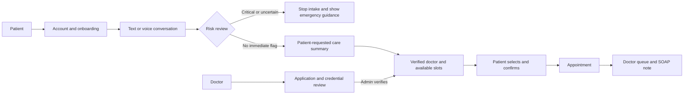
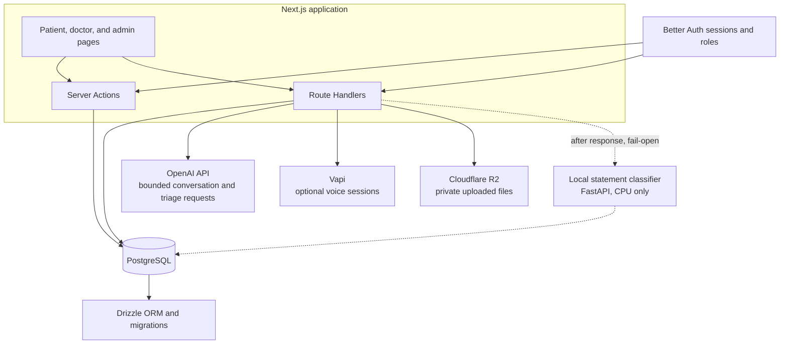
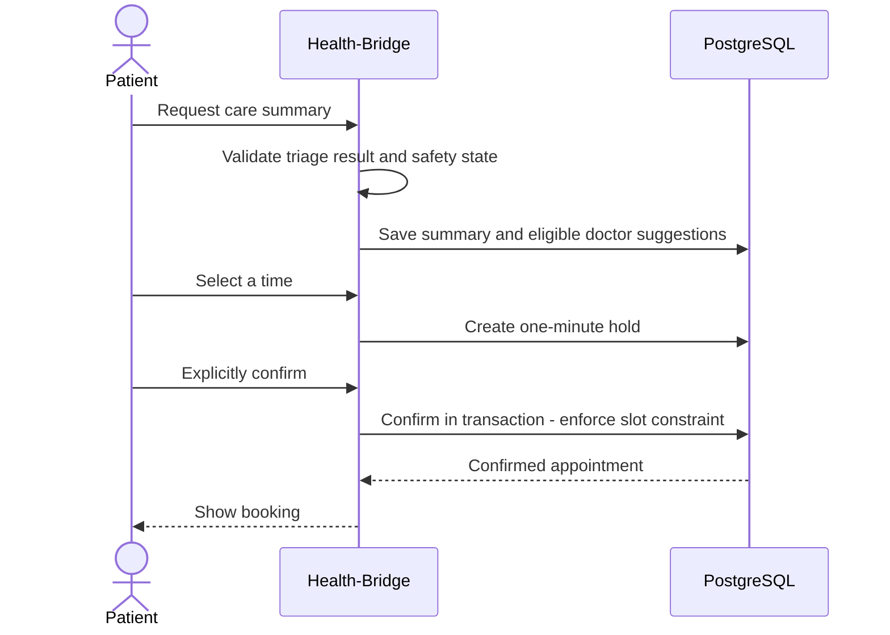

# Health-Bridge

**Multilingual, patient-led telehealth for a more connected care journey.**

Health-Bridge is an Indian-language-first healthcare application built around patient onboarding, verified doctor discovery, consent-based AI conversations, cautious triage, and appointment scheduling. Patients stay in control of whether to book; doctors review their assigned appointments and clinical handoff notes.

> **Project status:** Phases 1–5 are implemented on `main`. This is an actively developed product foundation, not a substitute for medical care. AI output is an intake aid for clinician review, not a diagnosis or treatment recommendation.

## Product at a glance



## Implemented capabilities

### Patients

- Email account registration, verification, sign-in, and role-aware navigation.
- Guided onboarding and profile settings, including profile image upload.
- Dashboard sections for doctor search, appointments, AI conversations, and health history.
- Doctor directory limited to verified clinicians, with profiles and available consultation modes.
- Consent-gated text conversations and optional Vapi voice sessions in the same conversation thread.
- Conversation risk review. Critical, uncertain, unavailable, or rate-limited review stops the intake rather than suggesting an appointment. Deterministic red-flag rules remain disabled pending clinical review.
- An explicit, bounded care-summary request that validates the AI response before saving triage and SOAP data.
- Matching against verified doctors using department, language, consultation mode, and available time.
- One-minute appointment holds, explicit patient confirmation, cancellation, history, and rescheduling. Database constraints and transactions protect booking conflicts.
- An offline-capable application shell and cached doctor-directory support.

### Doctors and administrators

- Doctor application wizard that saves progress, accepts required document types, and tracks verification status.
- Private doctor document storage through Cloudflare R2's S3-compatible API.
- Admin application review and verification controls.
- Verified-doctor appointment queue, severity ordering, and editable SOAP notes for assigned appointments.
- Doctor-visible patient statements with an experimental category label and a clinician correction control. The label is a documentation aid only: it never diagnoses, never scores severity, and never touches the emergency path.

### Current scope boundaries

The repository does not yet implement live video/audio consultations, prescription OCR, medication reminders, scheduled follow-ups, external emergency-service dispatch, or payment processing. Doctor availability and time-off data support slot generation, but a complete availability-management workspace is not currently part of the shipped UI. Background job and messaging variables in `.env.example` are reserved for future phases and are not active integrations.

## Architecture



The dashed path is the experimental classifier. It runs after a turn is committed, cannot
block intake, and is not part of the risk or emergency path. See [`ml/README.md`](ml/README.md).

### Appointment confirmation



## Technology

| Area | Implementation |
|---|---|
| Web framework | Next.js 16 App Router, React 19, TypeScript |
| UI | Tailwind CSS 4, shadcn-based components, Base UI primitives |
| Authentication | Better Auth; email delivery through Resend |
| Database | PostgreSQL 17, Drizzle ORM, drizzle-kit migrations |
| Validation | Zod |
| AI | OpenAI Chat Completions API with bounded context/output and schema validation |
| Voice | Vapi Web SDK and server routes (optional configuration) |
| Object storage | Cloudflare R2 via the AWS S3 SDK |
| Offline support | Service worker and local doctor-directory cache |
| Package manager | pnpm |

## Local development

### Requirements

- Node.js compatible with the installed Next.js version.
- pnpm.
- Docker with Docker Compose for the local PostgreSQL 17 service.
- Local environment variables. See [`.env.example`](.env.example) for variable names and which integrations require configuration. Keep actual values out of version control.

### Start the app

1. Install dependencies:

   ```bash
   pnpm install
   ```

2. Configure the variables listed in `.env.example` in your local environment. `DATABASE_URL` must point to the local database described in `docker-compose.yml` for this setup. The example file contains names and empty/example defaults only; never use production secrets in local development.

3. Make the database connection available to Drizzle and apply migrations:

   ```bash
   npx drizzle-kit migrate
   ```

4. Start the development server (this starts the `health-bridge-pg` Docker service first):

   ```bash
   pnpm dev
   ```

5. Open [http://localhost:3000](http://localhost:3000).

To bootstrap the first administrator, set `ADMIN_BOOTSTRAP_EMAIL` and `ADMIN_BOOTSTRAP_PASSWORD` locally, then run:

```bash
pnpm db:seed
```

The seed script does not reset an existing administrator's password.

### Useful commands

| Command | Purpose |
|---|---|
| `pnpm dev` | Start local Postgres with Docker Compose and run Next.js in development mode |
| `pnpm run build` | Create a production build |
| `pnpm lint` | Run ESLint |
| `pnpm test` | Run the TypeScript unit tests (Vitest) |
| `pnpm vitest run --config vitest.live.config.ts` | Run live integration tests (needs Postgres and the ML service) |
| `npx drizzle-kit generate` | Generate a migration from schema changes |
| `npx drizzle-kit migrate` | Apply pending Drizzle migrations |
| `npx drizzle-kit check` | Check migration consistency |
| `pnpm db:seed` | Bootstrap the first administrator |

### Optional: the statement classifier

The experimental statement classifier in [`ml/`](ml/README.md) runs locally and is entirely
optional. Without it, intake behaves exactly as before.

```bash
python3 -m venv ml/.venv && ml/.venv/bin/pip install -r ml/requirements.txt
ml/.venv/bin/python ml/train.py
ml/.venv/bin/uvicorn api:app --app-dir ml --host 127.0.0.1 --port 8000
```

The app calls it at `ML_SERVICE_URL` (default `http://127.0.0.1:8000`) and fails open if it
is unreachable.

## Configuration

The committed [`.env.example`](.env.example) is the configuration reference. It documents the variables for:

- PostgreSQL and Better Auth.
- Optional GitHub and Google OAuth providers.
- Resend email verification.
- Private R2 document storage.
- Admin bootstrap.
- Optional OpenAI-backed AI and Vapi voice.
- Optional local statement classifier (`ML_SERVICE_URL`, `ML_CLASSIFIER_DISABLED`).
- Future OCR, messaging, and background-job integrations, which are not active product features yet.

Do not commit credentials, real user data, uploaded medical documents, or local database files. Keep doctor documents private and serve them only through the application's authorization checks.

## Repository map

```text
app/                 App Router pages and API route handlers
modules/             Patient, doctor, and authentication UI/actions
lib/                 Auth, database schema, AI, scheduling, storage, utilities
drizzle/              PostgreSQL migrations and migration metadata
scripts/              Local administrative seed script
public/               Static assets, offline page, and service worker
ml/                   Experimental local statement classifier (Python); see ml/README.md
tests/                Vitest suites, including live integration tests
HEALTH-BRIDGE.md      Product specification and phased roadmap
PHASE-5-PROGRESS.md   Phase 5 implementation and verification checkpoint
```

## Delivery history

| Phase | Delivered |
|---|---|
| 1 — Foundation | App foundation, Better Auth, email verification, database schema and shared UI base |
| 2 — Doctor verification | Doctor onboarding, credential uploads, admin review, and verification workflow |
| 3 — Patient experience | Patient dashboard, profile/onboarding, navigation, and offline shell |
| 4 — AI intake and voice | Consent-based patient conversation, risk-aware intake, and optional Vapi voice flow |
| 5 — Triage and appointments | Validated care summary, verified-doctor matching, slot holds, confirmation, cancellation/rescheduling, doctor queue, and SOAP review |
| 6 — Statement classifier | Experimental local, CPU-only classifier that categorises patient statements for clinician review. Synthetic-only benchmark, fail-open integration, and no coupling to the risk or HALT path. |

For detailed implementation decisions and the broader product roadmap, see [`HEALTH-BRIDGE.md`](HEALTH-BRIDGE.md). Phase-level resume notes are kept in [`PHASE-5-PROGRESS.md`](PHASE-5-PROGRESS.md).
