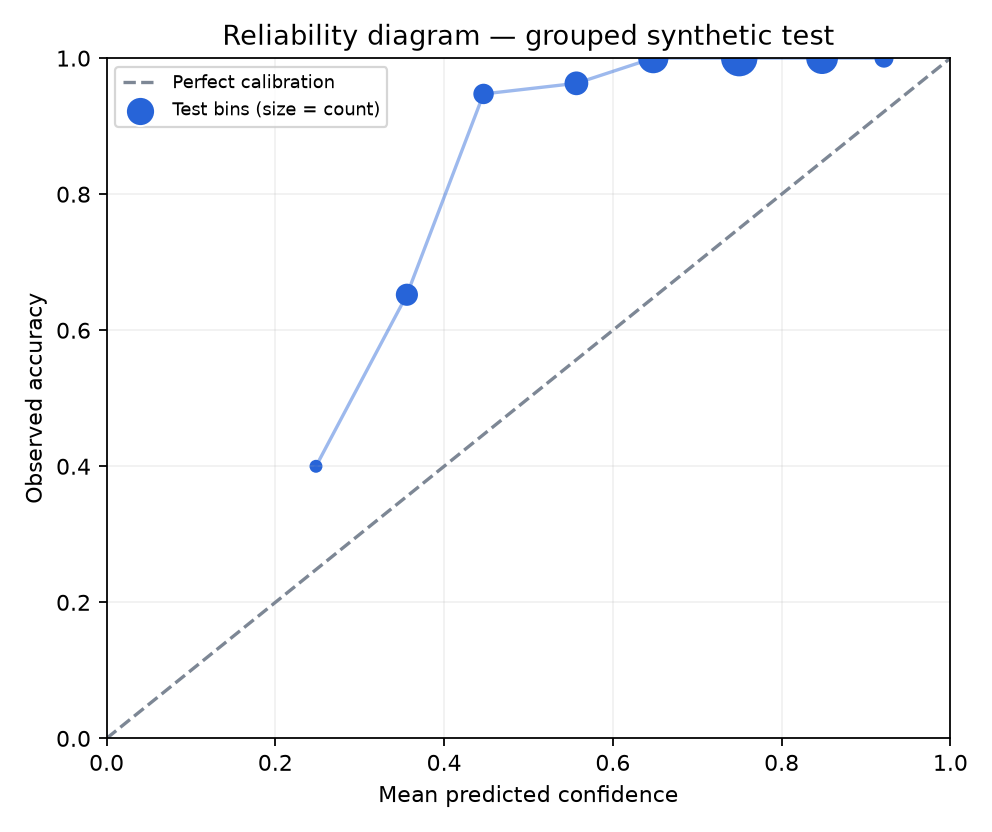

# Phase B experiment report

Run: `2026-10-21T16:59:11.891999+00:00`

> All core metrics below use the existing synthetic dataset. They measure learnability of the project’s label scheme, not real-world clinical performance.

## Grouped-split baselines

| Model | Validation macro-F1 | Test accuracy | Test macro-F1 |
|---|---:|---:|---:|
| majority | 0.0805 | 0.3098 | 0.0788 |
| keyword | 0.6309 | 0.6078 | 0.5645 |
| word_logreg | 0.8887 | 0.9255 | 0.9248 |
| char_logreg | 0.9718 | 0.9490 | 0.9404 |
| word_char_logreg | 0.9684 | 0.9608 | 0.9575 |
| word_linear_svm | 0.8975 | 0.9255 | 0.9248 |
| MuRIL fine-tuned CPU (afd9f36c) | 0.0805 | 0.3098 | 0.0788 |

## Calibration

Ten-bin expected calibration error: **0.2756**.
At confidence threshold 0.45, coverage was 84.3% and accuracy among covered examples was 99.5%.
This is a descriptive operating point, not evidence that 0.45 is a clinically justified threshold.

## Cross-lingual transfer

A character n-gram model trained on 264 English-only examples was evaluated on Hindi and Hinglish held-out examples:

- `hi` (n=63): macro-F1 0.2870; accuracy 0.4762.
- `hinglish` (n=84): macro-F1 0.4908; accuracy 0.5119.

## Split ablation

Grouped char-model test macro-F1: 0.9404; row-random test macro-F1: 0.9931.
The random split allows statements from the same scenario template into multiple partitions and is included only to quantify leakage sensitivity.

## SMM4H real-data experiment

The public release contains tweet IDs, user IDs, and labels only; its README prohibits redistributing tweets, annotations, or the resulting corpus. Text is not available in this environment under a non-paid, compliant route.

The SMM4H-trained comparison is therefore not reported. No real-world efficacy claim can be made from this run.

## Error slices

Per-language, per-label, and example-level errors are in `metrics.json`.

## Multilingual transformer

MuRIL (`afd9f36c7923d54e97903922ff1b260d091d202f`) was partially fine-tuned on CPU for 3 epochs. The task head and top encoder block were trainable; lower layers were frozen.
Best validation macro-F1: 0.0805. Grouped held-out test accuracy: 0.3098; macro-F1: 0.0788.
This run collapsed to the majority label and did not outperform the TF-IDF baseline. It is included as a transparent negative result; it is not evidence that MuRIL is generally unsuitable.

## Limitations

- Synthetic metrics measure learnability of the authored label scheme.
- No clinician adjudication; single-annotator labels; no real patient data.
- Mixed-language held-out subset is small.
- No clinical, diagnostic, triage, severity, or emergency performance claim.
